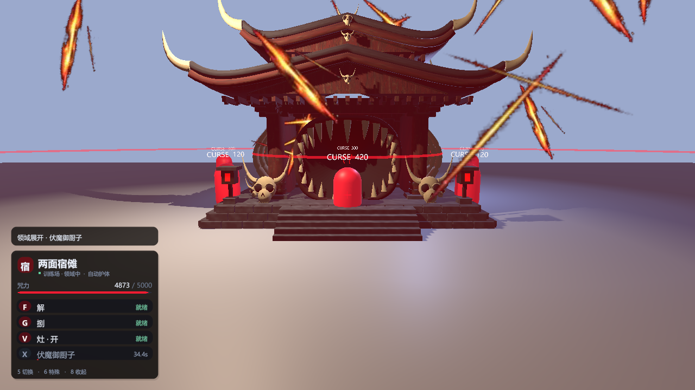
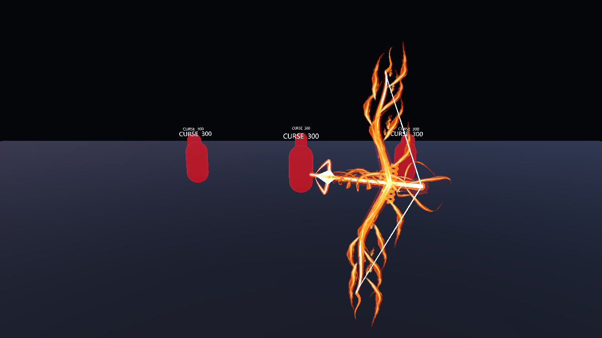
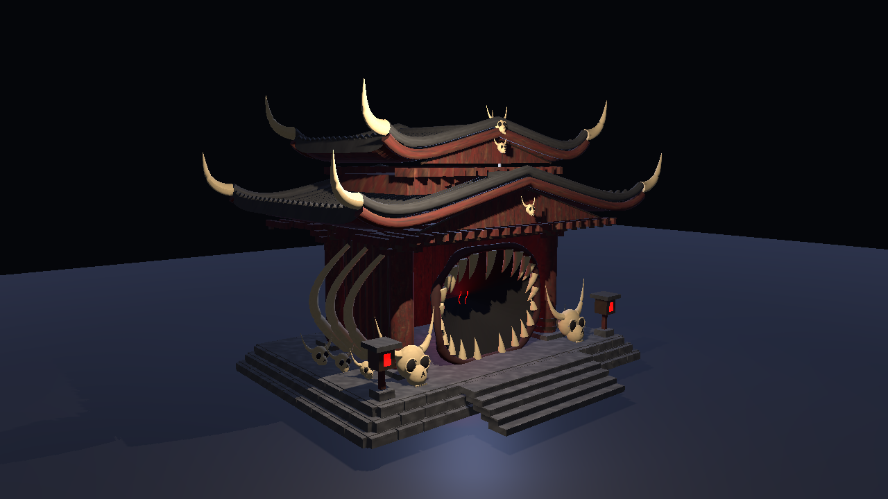

# Crime Simulator · 咒术回战技能模组

**v1.4.0 · Windows x64 · Unity Mono · BepInEx 5**

单人术式玩法模组：五条悟与两面宿傩共八个技能，包含咒力护体、立体火焰弓箭、开放式领域和原生技能面板。

**[下载 v1.4.0](https://github.com/guiyuan98/crime-simulator-jujutsu-mod/releases/tag/v1.4.0)** · [测试记录](docs/TESTING.md) · [素材和依赖说明](THIRD_PARTY.md)



## 安装

1. 退出游戏。准备 Windows x64 的 Crime Simulator **Mono** 版本；已测试环境为 Unity 2022.3.62f3、BepInEx 5.4.23.5。
2. 若未安装加载器，先按 [BepInEx 官方文档](https://docs.bepinex.dev/articles/user_guide/installation/index.html) 安装 **BepInEx 5.x Windows x64 / Mono**，运行一次游戏以生成配置，再退出。
3. 下载 Release 中的 `JujutsuLocal-v1.4.0-win-x64.zip`，将压缩包内的 `BepInEx` 文件夹合并到游戏根目录。升级前可备份本模组自己的配置。
4. 在已有的 `BepInEx/config/BepInEx.cfg` 中确认以下设置；只修改这个字段，不覆盖其他加载器配置：

   ```ini
   [Chainloader]
   HideManagerGameObject = true
   ```

5. 从 Steam 正常启动游戏，进入单人地图。左下出现术式卡片后即可使用；按 **5** 切换到宿傩。

下载包只包含模组 DLL、默认配置与说明；**不包含游戏程序、游戏程序集或 BepInEx 本体**。

## 按键

| 按键 | 宿傩 | 五条悟 |
|---|---|---|
| **F** | 解 | 术式顺转·苍 |
| **G** | 捌 | 术式反转·赫 |
| **V** | 灶·开 | 虚式·茈 |
| **X** | 伏魔御厨子 | 无量空处 |

- **5**：切换角色；**6**：特殊能力（无下限 / 反转术式）。
- **7**：训练靶；**8**：显示/收起面板；**9**：启停模组。
- **0**：在主菜单进入训练场，再按返回；WASD 移动，鼠标瞄准，空格跳跃，Esc 释放/锁定鼠标。
- 数字辅助键同时兼容上排与小键盘。旧数字 **1–4** 不再施放模组技能。
- 保存 `BepInEx/config/local.crimesimulator.jujutsu.cfg` 后，按键配置约1秒自动重载。

原游戏的 F 手电、G 丢放物品、X 换弹与模组重合：技能就绪时临时隔离同键动作，暂停、聊天、停用或退出时恢复；不改写原游戏控制配置。

## 技能与界面

- 初始与上限咒力 **5000**，每秒恢复9；常规身体伤害优先消耗咒力抵挡，不足部分按原游戏结算。
- 所有有伤害的模组术式为原基础伤害 **×10**；无量空处仍以控制为主。
- 宿傩技能终结的 NPC 本局不再苏醒；原游戏警戒、护甲与致命攻击后果继续生效。
- 灶·开有 **1.2秒蓄力**，包含实体火焰弓、四瓣箭头、同步拉弦、拖尾和命中火焰。
- 伏魔御厨子为开放式领域：真实3D神龛、密集持续斩击，没有包围玩家的碰撞墙。
- 左下圆角技能卡片显示实际按键、咒力、冷却与状态；通知不再覆盖物品栏中央。





## 本地构建

依赖合法安装的游戏及 BepInEx。仓库不分发它们的程序集。

```powershell
.\Build.ps1 -GamePath 'D:\SteamLibrary\steamapps\common\Crime Simulator'
```

脚本使用 Windows 自带的 .NET Framework C# 编译器，读取游戏 `Managed` 与 BepInEx `core` 目录，嵌入 `assets/` 中的资源，并运行规则测试。输出为 `dist/JujutsuMod.dll`；不写游戏目录。

DLL 编译标识可能因编译环境改变而不同；Release 附带 SHA-256 校验文件。其他游戏补丁及多人协作未做完整验证。

## 卸载

退出游戏后移除 `BepInEx/plugins/JujutsuLocal/JujutsuMod.dll`；配置可自行保留。不要删除其他模组或加载器。

## 发布内容

源码、所需图像资源、默认配置和整理后的测试记录；不包含游戏文件、反编译记录、账号凭据、个人路径、调试日志与旧版备份。

这是非官方模组。本仓库暂未选择开源许可证；依赖和素材说明见 [THIRD_PARTY.md](THIRD_PARTY.md)。
